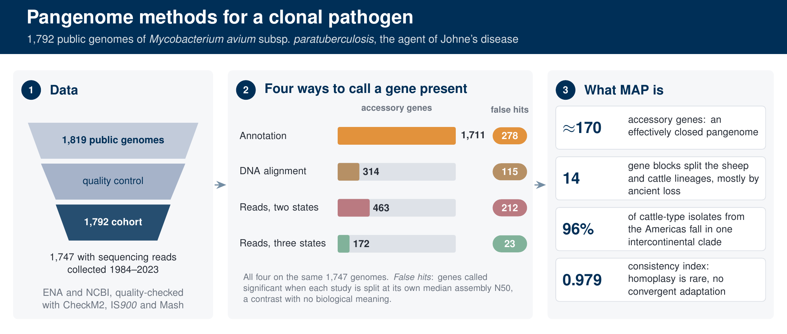

<p align="center">
  
</p>

<h1 align="center">Pangenome methods for a clonal pathogen</h1>

<p align="center">
  <em>Population genomics of 1,792 public genomes of</em> Mycobacterium avium <em>subsp.</em> paratuberculosis
</p>

<p align="center">
  <a href="LICENSE"></a>
  
  
  
  <!-- After the first Zenodo release, replace the line below with the DOI badge Zenodo gives you -->
  
</p>

---

## About

*Mycobacterium avium* subsp. *paratuberculosis* (MAP) causes Johne's disease, a chronic enteritis of cattle, sheep and other ruminants. Published estimates of its accessory genome differ by an order of magnitude. This repository contains the complete analysis workflow used to ask whether that disagreement is biological or methodological.

Gene clusters were defined once and then scored in **four independent ways**, from annotations, from DNA alignment and from read coverage in two and in three states. Every call was tested against the same **within-study negative control**: the genomes of each study are split at that study's own median assembly quality, a contrast with no biological meaning, so any gene a method reports as significant there is an artefact. MAP is a good test organism for this because it is clonal, which restricts the shapes a genuine signal can take.

## Key results

| | |
|---|---|
| **Effectively closed pangenome** | about 170 accessory genes from read-verified calls, against 1,711 from annotation on the same genomes |
| **Method matters more than biology** | the annotation call produced 278 false hits in the negative control; the three-state read call produced 23 |
| **Ancient reciprocal gene loss** | 119 genes in 14 blocks separate the sheep and cattle lineages; 99 are present in the outgroup *M. avium* 104 |
| **One intercontinental clade** | 96% of American and 95% of Oceanian cattle-type isolates fall in a single derived clade |
| **No convergent adaptation** | consistency index 0.979; the most recurrent site is a reversion to the ancestral allele |
| **Signals that track sampling** | gene associations, the apparent molecular clock and origin prediction all fail their controls |

## The four gene-presence methods

All four are evaluated on the same 1,747 genomes for which sequencing reads are available.

| Method | Evidence that a gene is present | Accessory genes | False hits |
|---|---|---:|---:|
| Annotation | annotated in the assembly (Panaroo matrix) | 1,711 | 278 |
| DNA alignment | annotated, **or** representative sequence aligns at ≥ 0.9 identity over ≥ 0.8 of its length, merged across contigs | 314 | 115 |
| Reads, two states | read breadth of coverage ≥ 80 % | 463 | 212 |
| Reads, three states | ≥ 80 % present, < 20 % absent, undetermined in between | **172** | **23** |

*False hits*: genes significant (Fisher's exact test, Bonferroni within study) when each study with ≥ 60 genomes is split at its own median N50.

## Workflow

The analysis is a numbered sequence of scripts. Each reads the outputs of earlier steps from fixed directories, so any step can be repeated on its own. Batch steps are submitted with Slurm (`.sbatch`); the rest run interactively. A one-line description of every script is in [`scripts/INDEX.md`](scripts/INDEX.md).

| Stage | Scripts | What happens |
|---|---|---|
| Cohort and quality control | `00`–`09` | collect public genomes, QUAST and CheckM2, species checks, metadata curation and enrichment, final cohort |
| Gene clustering | `10`–`11` | Panaroo; Roary on the same annotations for comparison |
| Phylogeny and typing | `12`–`17` | Snippy against K-10 with repeats masked, Gubbins, IQ-TREE, lineage assignment |
| Association and batch checks | `18`–`22` | Scoary, sequencing-batch and contig-edge tests |
| Gene-presence methods | `23`–`26` | DNA-based presence, union call, negative and positive controls |
| Mixed-model association | `27`–`30` | pyseer with phylogenetic kinship |
| Read-based verification | `33`–`36` | read mapping, two- and three-state presence calls, mixed-sample index |
| Homoplasy and convergence | `31`, `37`, `44`–`51` | read-verified homoplasy, topology tests, gene-level convergence, outgroup polarisation |
| Temporal signal | `38`–`41`, `52` | date parsing, root-to-tip regression, permutation tests, per-study rates |
| Prediction of origin | `32`, `43` | nearest-relative baselines, regularised regression, random forests |
| Outputs | `53`–`56` | figures and supplemental tables, functional annotation of lineage genes |
| Robustness | `57`–`60` | typing-panel checks, sensitivity to mixed samples and cohort composition |

## Repository layout

```
.
├── docs/            overview figure and its TikZ source
├── scripts/         the numbered workflow, 00–60
├── envs/            conda environment specifications with exact versions
├── metadata/        cohort accession list, curated metadata, K-10 mask, anchor genomes
├── results/         small derived tables the figures and manuscript are built from
└── figures/         publication figures as PDF
```

Raw reads, assemblies, annotations and the large intermediate matrices are **not** in this repository. They are public, and every accession is listed in `metadata/`; the paths below say how to regenerate the rest.

## Reproducing the analysis

```bash
# 1. environments (one per tool family)
conda env create -f envs/ml_env.yml
conda env create -f envs/r_fig.yml
#    ... and the others you need for the step you are repeating

# 2. fetch the cohort
bash scripts/01_collect_genomes.sh

# 3. run a step
conda activate ml_env
python scripts/24_dna_pangenome.py

# 4. batch steps go to Slurm
sbatch scripts/14_gubbins_iqtree.sbatch
```

Random seeds are fixed in every script that resamples, permutes or cross-validates, so permutation *P* values, accumulation curves and cross-validation scores reproduce exactly. The Gubbins and IQ-TREE searches are stochastic in ways outside our control; they are documented by version and full command instead.

## Software

| Tool | Version | | Tool | Version |
|---|---|---|---|---|
| Trimmomatic | 0.40 | | Gubbins | 2.3.4 |
| SPAdes | 3.11.1 | | IQ-TREE | 3.1.3 |
| Prokka | 1.15.6 | | Scoary | 1.6.16 |
| QUAST | 5.0.2 | | pyseer | 1.4.2 |
| CheckM2 | 1.0.2 | | BactDating | 1.1.4 |
| Mash | 2.3 | | eggNOG-mapper | 5.0.2 |
| Panaroo | 1.6.0 | | scikit-learn | 1.5.2 |
| Roary | 3.12.0 | | Python | 3.11.18 |
| minimap2 | 2.28 | | R | 4.3.3 / 4.4.3 |
| Snippy | 4.6.0 | | samtools / bcftools | 1.20 / 1.21 |

## Data availability

All genomes are public. ENA and NCBI accessions, curated metadata, quality statistics and lineage assignments are in `metadata/cohort_metadata.tsv`. Reference genomes used: K-10 (`AE016958.1`), Telford (`CP033688.1`) and *M. avium* 104 (`CP000479.1`).

## Citation

If you use this code or the curated cohort, please cite the paper and this repository. See [`CITATION.cff`](CITATION.cff).

## License

Code is released under the [MIT License](LICENSE). The sequence data are public and remain under the terms of their original archives.
